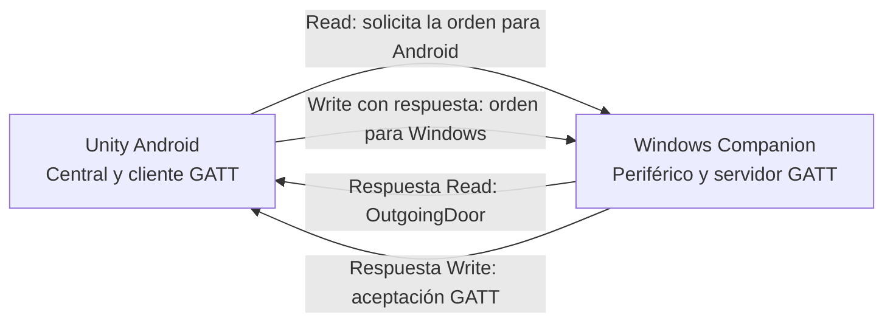
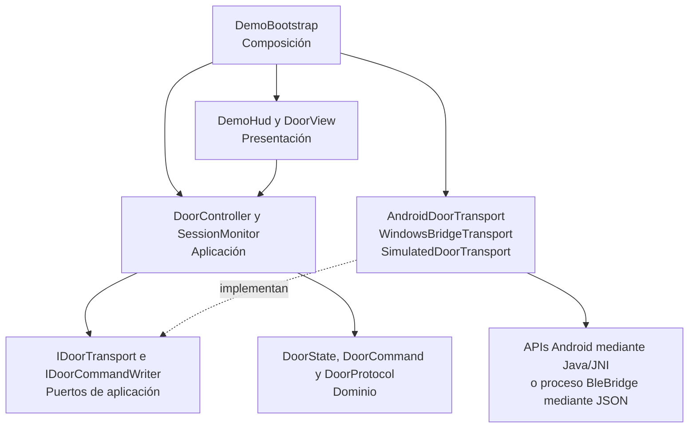

# Arquitectura de Connected Room

Connected Room integra una app Unity para Android con una aplicación Windows mediante Bluetooth Low Energy. Cada aplicación representa una puerta y permite enviar órdenes a la otra. **Solo la puerta receptora cambia al recibir una orden**; enviar una orden o recibir su confirmación conserva el estado de la puerta emisora.

La solución usa una arquitectura por capas con puertos y adaptadores. El dominio valida el protocolo, la aplicación coordina la sesión y los adaptadores contienen las APIs de plataforma. La composición de objetos es manual y explícita.

Para seguir las operaciones paso a paso, consultar [Flujos del sistema](FLOWS.md). Para ejecutar las dos aplicaciones, ver [Prueba bidireccional](BIDIRECTIONAL.md).

## Aplicaciones y roles BLE

| Aplicación | Tecnología | Rol | Responsabilidad |
|---|---|---|---|
| Android | Unity C#, IL2CPP y plugin Java mediante JNI | Central y cliente GATT | Descubrir Windows, leer órdenes entrantes y escribir órdenes dirigidas a Windows |
| Windows Companion | .NET 10, WinForms y WinRT | Periférico y servidor GATT | Anunciar el servicio, responder lecturas y aceptar escrituras |
| Cliente de escritorio opcional | Unity y proceso BleBridge | Central y cliente GATT | Probar lecturas desde el editor o desde un player Windows |
| Consola periférica opcional | BleBridge con `--peripheral` | Periférico y servidor GATT | Publicar valores manuales usando el mismo host que Windows Companion |

El recorrido principal usa Android y Windows Companion. El editor Unity y la consola son herramientas alternativas; no forman parte del proceso del APK. Windows Companion tiene su propia interfaz WinForms y animación, separadas del player Unity.



BLE transporta un estado deseado de un byte. La geometría de las puertas es una visualización de software; no existe un actuador físico conectado a estas aplicaciones.

## Capas y dependencias de Unity



Las flechas sólidas indican uso o construcción; la flecha discontinua indica implementación de los puertos. La presentación observa eventos del controlador para actualizar la vista.

| Capa | Archivos principales | Contrato |
|---|---|---|
| Dominio | [DoorCommand](../Assets/DoorDemo/Core/Domain/DoorCommand.cs), [DoorState](../Assets/DoorDemo/Core/Domain/DoorState.cs), [DoorProtocol](../Assets/DoorDemo/Core/Domain/DoorProtocol.cs) | Aceptar exactamente `00` o `01` y definir los UUID predeterminados |
| Aplicación | [DoorController](../Assets/DoorDemo/Core/Application/DoorController.cs) | Coordinar conexión, validar lecturas y separar comandos recibidos de enviados |
| Puertos | [IDoorTransport](../Assets/DoorDemo/Core/Application/IDoorTransport.cs), [IDoorCommandWriter](../Assets/DoorDemo/Core/Application/IDoorCommandWriter.cs) | Entregar valores y estados; ofrecer escritura como capacidad independiente |
| Observación | [SessionMonitor](../Assets/DoorDemo/Core/Application/SessionMonitor.cs) | Mantener seis eventos recientes y contar aperturas recibidas con un reloj inyectado |
| Infraestructura | [AndroidDoorTransport](../Assets/DoorDemo/Infrastructure/AndroidDoorTransport.cs), [WindowsBridgeTransport](../Assets/DoorDemo/Infrastructure/WindowsBridgeTransport.cs), [SimulatedDoorTransport](../Assets/DoorDemo/Infrastructure/SimulatedDoorTransport.cs) | Adaptar JNI, procesos o simulación a los puertos |
| Presentación | [DemoHud](../Assets/DoorDemo/Presentation/DemoHud.cs), [DoorView](../Assets/DoorDemo/Presentation/DoorView.cs), [DemoSceneFactory](../Assets/DoorDemo/Presentation/DemoSceneFactory.cs) | Mostrar controles, construir la escena y animar el estado recibido |
| Composición | [DemoBootstrap](../Assets/DoorDemo/Presentation/DemoBootstrap.cs) | Elegir el transporte, inyectarlo y gestionar el ciclo de vida de la sesión |

Dominio y aplicación comparten el ensamblado `DoorDemo.Core`, cuyo `.asmdef` declara `noEngineReferences: true`. `DoorDemo.Infrastructure` referencia Core; `DoorDemo.Presentation` referencia Core e Infrastructure para poder componer los adaptadores. No se necesita un contenedor de inyección de dependencias.

`IDoorCommandWriter` está separado de `IDoorTransport` porque un transporte puede admitir solo lectura. `DoorController.CanControl` exige conexión establecida y un escritor disponible. El adaptador Android y el simulado implementan ambos puertos; el cliente Windows opcional implementa el de recepción.

## Composición y configuración

`DemoBootstrap.Start` valida [DemoSettings](../Assets/DoorDemo/Presentation/DemoSettings.cs), crea escena y HUD, y selecciona el modo real. `SetMode` elige el adaptador según el modo y la plataforma:

| Contexto | Adaptador | Dependencia externa |
|---|---|---|
| Android fuera del editor | `AndroidDoorTransport` | Plugin AAR compilado desde Java |
| Editor o player de escritorio | `WindowsBridgeTransport` | `BleBridge.exe`, publicado previamente |
| Modo de prueba | `SimulatedDoorTransport` | Eventos en memoria |

La configuración de la escena está en [DoorDemoSettings.asset](../Assets/DoorDemo/Configuration/DoorDemoSettings.asset). Incluye los UUID y la velocidad de animación. Los UUID del host Windows usan los valores de `DoorProtocol`; cualquier cambio de identidad debe mantenerse consistente en ambos extremos.

El editor busca el helper en `Artifacts/BleBridge`; el player de escritorio lo busca en `StreamingAssets/BleBridge`. [DemoProjectTools](../Assets/DoorDemo/Editor/DemoProjectTools.cs) prepara la escena y las builds. El material y la malla de la sala se incluyen en `Resources` y se cargan explícitamente para conservar las dependencias necesarias en IL2CPP.

## Integración nativa de Android

El código de radio está en [Native/AndroidBle](../Native/AndroidBle). `AndroidDoorTransport` solicita permisos e invoca `AndroidBleBridge` mediante `AndroidJavaObject`. El AAR se genera a partir de esas fuentes con `Tools/Build-AndroidPlugin.ps1`.

| Colaborador Java | Responsabilidad |
|---|---|
| [AndroidBleBridge](../Native/AndroidBle/src/com/portfolio/connectedroom/AndroidBleBridge.java) | Punto de entrada JNI, comprobación de radio y plataforma, composición e invalidación de sesiones |
| [BleDiscovery](../Native/AndroidBle/src/com/portfolio/connectedroom/BleDiscovery.java) | Escaneo filtrado por UUID, selección del primer resultado y timeout de búsqueda |
| [GattDoorConnection](../Native/AndroidBle/src/com/portfolio/connectedroom/GattDoorConnection.java) | Conexión, descubrimiento GATT, serialización de Read/Write y watchdog de operaciones |
| [BridgeEvents](../Native/AndroidBle/src/com/portfolio/connectedroom/BridgeEvents.java) | Cola acotada de mensajes JSON consumida desde C# |

Las operaciones y callbacks de radio se procesan mediante un `Handler` en el Looper principal de Android. El hilo de Unity consume los eventos en `DemoBootstrap.Update → DoorController.Pump → AndroidDoorTransport.Pump`. Los callbacks Java no acceden a GameObjects.

La cola admite 128 mensajes y el adaptador procesa hasta 128 por frame. Una saturación se comunica como error y requiere reconectar. La identificación de generación y de la instancia GATT evita aplicar callbacks pertenecientes a una conexión reemplazada.

## Servidor y presentación Windows

[Program](../Native/WindowsCompanion/Program.cs) construye un [GattSensorHost](../Native/Shared/GattSensorHost.cs) y lo inyecta en [MainForm](../Native/WindowsCompanion/MainForm.cs). El formulario administra controles y registro; [DoorPanel](../Native/WindowsCompanion/DoorPanel.cs) realiza la animación. El host encapsula `GattServiceProvider` y la característica WinRT.

El host posee dos instancias independientes de [DoorSensorState](../Native/Shared/DoorSensorState.cs):

| Estado | Quién lo actualiza | Quién lo consume |
|---|---|---|
| `OutgoingDoor` | Botones Windows | Android mediante Read |
| `ReceivedDoor` | Escrituras BLE de Android | La puerta Windows mediante su evento `Changed` |

`MainForm` solo conecta `ReceivedDoor` a la animación local. Un cambio de `OutgoingDoor` genera una entrada de registro y queda disponible para la siguiente lectura. Los callbacks WinRT se entregan a la interfaz mediante `OnUi` y `BeginInvoke`; se descartan actualizaciones cuando el formulario está cerrándose.

Los proyectos Windows incluyen los archivos de dominio mediante enlaces `Compile Include`, junto con `Native/Shared`. Así reutilizan la validación y los UUID sin introducir referencias a Unity. La consola periférica reutiliza el mismo host; su interfaz de entrada es diferente.

El estado de advertising indica que el servicio se anuncia. No equivale a una confirmación de que un cliente esté conectado. Los contadores de Read y Write permiten observar tráfico atendido por el host.

## Protocolo y contratos internos

| Campo | Valor |
|---|---|
| Servicio | `7b9c0001-6d7a-4f20-9a11-2c6e815a4400` |
| Característica | `7b9c0002-6d7a-4f20-9a11-2c6e815a4400` |
| Propiedades del recorrido Android | Read y Write con respuesta |
| Payload | Un byte binario: `00` cerrar o `01` abrir |
| Protección del prototipo | Read/Write sin autenticación ni cifrado exigido por el servicio |

La característica devuelve `OutgoingDoor` al leer y actualiza `ReceivedDoor` al escribir. Aunque comparte UUID, ambos sentidos usan estados separados. Un ACK representa la aceptación de la escritura GATT y aporta feedback sin cambiar la puerta emisora. No existe confirmación de un actuador físico.

El JSON es un contrato interno entre código nativo y Unity. El payload que cruza BLE sigue siendo un byte. [BridgeMessage](../Assets/DoorDemo/Infrastructure/BridgeMessage.cs) interpreta estos mensajes:

```json
{"type":"status","state":"connected","message":"Conectado a Windows."}
{"type":"value","hex":"01"}
{"type":"ack","hex":"01"}
```

`status` cambia la conexión; `value` aporta una orden recibida para la puerta Unity; `ack` informa una escritura aceptada por el peer. JSON desconocido, estados desconocidos y codificación hexadecimal incorrecta producen errores explícitos.

## Estado y recursos de cada sesión

`DoorController` separa el estado de conexión, `Door` y `HasReading`. `DoorState` solo contiene abierto o cerrado; la ausencia de una lectura se representa con `HasReading == false`. Una conexión GATT correcta puede existir antes de que el dominio acepte el contenido recibido.

Al perder conexión, Unity invalida la lectura, mueve su visualización a cerrado y muestra el indicador gris y **SIN DATO DEL SENSOR**. `SessionMonitor` no cuenta ese reinicio visual como una medición. Windows conserva en su host los últimos estados recibidos y enviados mientras viva esa instancia, incluso al detener y reiniciar advertising; su puerta no se reinicia por una lectura remota.

Cambiar de modo reemplaza controlador y monitor, desuscribe la vista y libera el transporte anterior. Al destruir la escena se realiza la misma limpieza. Una sesión Android ya conectada se desconecta al pasar a segundo plano; la reconexión se inicia manualmente. Al cerrar Windows, el formulario dispone el host, que invalida operaciones pendientes y desuscribe callbacks antes de detener advertising.

El helper de escritorio usa stdout para datos JSON y stderr para errores. `WindowsBridgeTransport` acota la cola, identifica cada generación del proceso y espera el fin de ambos streams antes de informar una salida inesperada. `ConsoleShutdown` coordina cierre de stdin y Ctrl+C con la liberación del token de cancelación.

## Decisiones de diseño y evolución

| Decisión actual | Motivo | Consecuencia |
|---|---|---|
| Puertos pequeños y composición manual | Separar radio y aplicación con pocos conceptos | Otro transporte puede incorporarse sin reescribir el controlador |
| Polling después de completar la lectura anterior | Mantener un recorrido GATT simple con una operación activa | El intervalo de 350 ms se suma a la duración de las operaciones; la latencia no es fija |
| Último estado deseado | Evitar una cola ilimitada de órdenes al pulsar rápidamente | Los estados intermedios pueden agruparse y no constituyen un historial de eventos garantizado |
| Reconexión manual | Hacer visibles los fallos y el control del ciclo de vida | El usuario debe pulsar Conectar tras recuperar radio o periférico |
| Registro acotado en memoria | Observar la sesión sin añadir persistencia | No ofrece auditoría durable ni recuperación entre ejecuciones |

Para incorporar otro periférico con el mismo contrato se ajustan los UUID y se comprueba su compatibilidad Read/Write. Un protocolo diferente requiere adaptar su decodificación y el modelo de aplicación. Varias salas requieren selección de dispositivo e instancias de sesión independientes; actualmente se usa el primer anunciante coincidente. Notify, autenticación, persistencia e iOS son extensiones que requieren diseño y validación específicos.

## Pruebas y navegación del código

Las [pruebas EditMode](../Assets/DoorDemo/Tests/EditMode) cubren validación binaria, controlador, aislamiento de comandos y ACK, historial, mensajes y cola entre generaciones. Las [pruebas PlayMode](../Assets/DoorDemo/Tests/PlayMode) cubren animación, carga de escena y recursos. El control de calidad exige métodos documentados y clases de hasta 300 líneas, sumando declaraciones parciales.

Consultar [VALIDATION.md](VALIDATION.md) para los resultados ejecutados y la separación entre pruebas automatizadas y pruebas previas con hardware, y [CONTRIBUTING.md](../CONTRIBUTING.md) para los comandos de validación.
