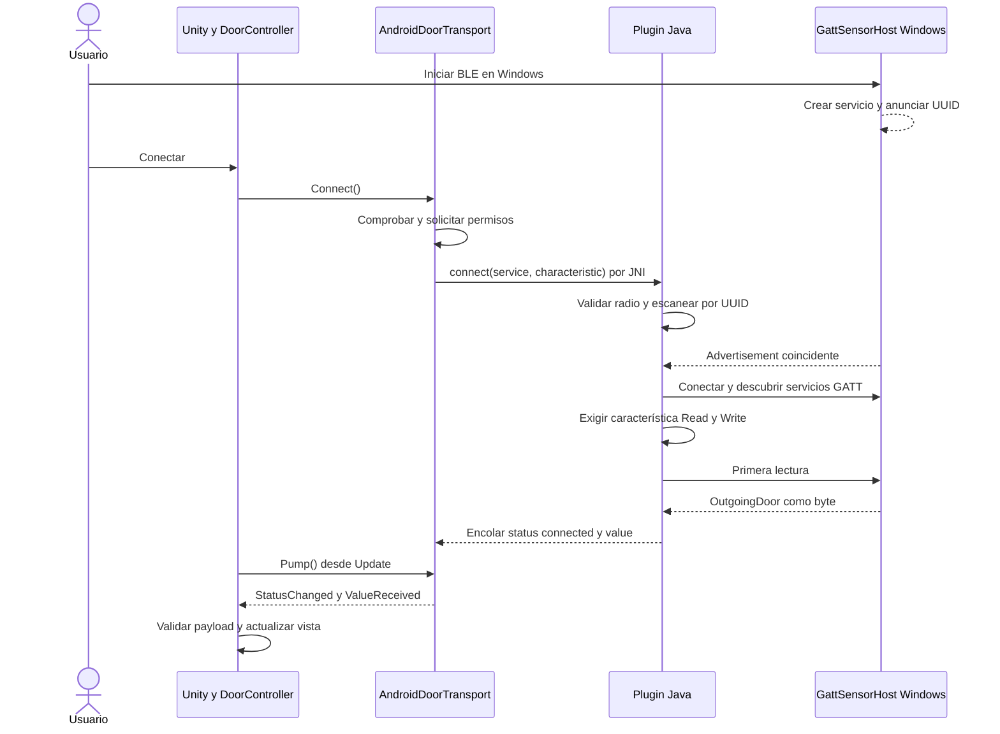
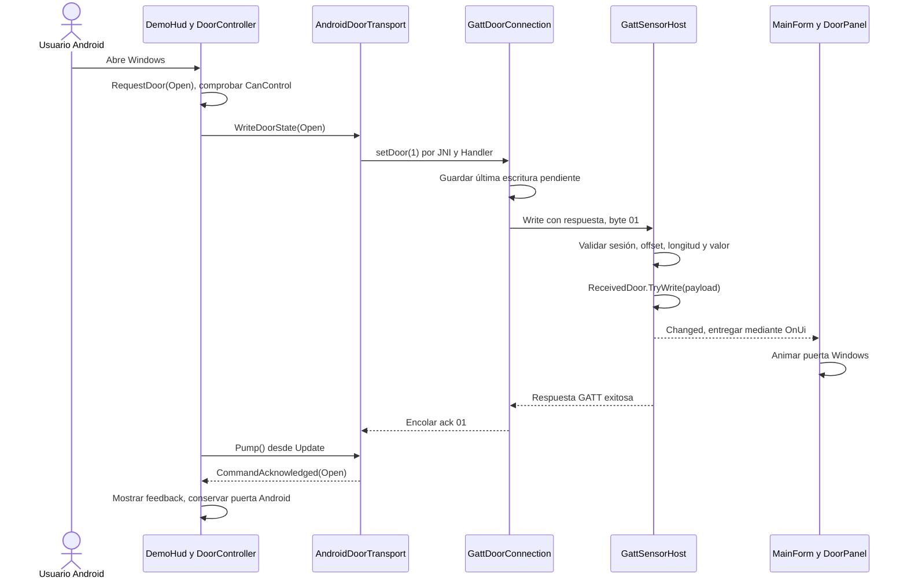
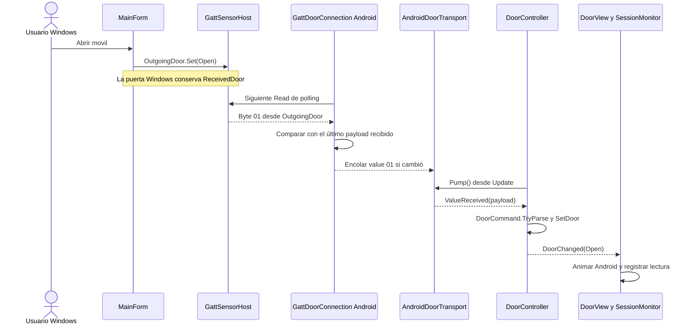
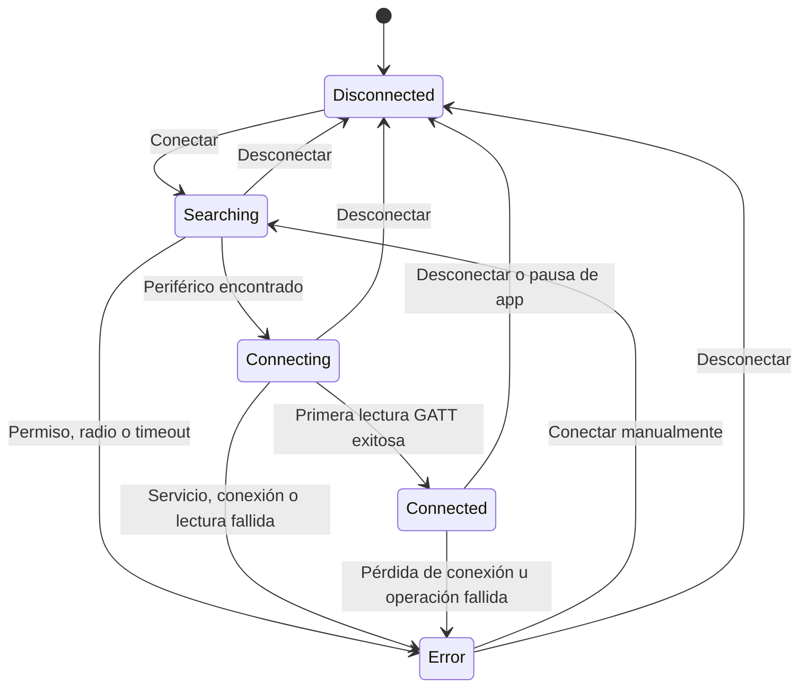

# Flujos de Connected Room

El recorrido principal conecta Unity Android como cliente GATT con Windows Companion como servidor. Las lecturas llevan el estado deseado de Windows hacia la puerta Android; las escrituras llevan el estado deseado de Android hacia la puerta Windows. Las confirmaciones de escritura se muestran como feedback y conservan la puerta emisora.

La [arquitectura](ARCHITECTURE.md) describe las responsabilidades de cada componente. Este documento sigue el orden de ejecución y los resultados observables.

## Inicio de las aplicaciones

| Extremo | Secuencia | Resultado inicial |
|---|---|---|
| Unity | `DemoBootstrap.Start → Validate → DemoSceneFactory.Create → DemoHud.Initialize → SetMode(false)` | Controlador desconectado, modo real seleccionado y puerta sin lectura válida |
| Windows | `Program.Main → new GattSensorHost → new MainForm(host)` | Interfaz disponible y servidor detenido |

Unity crea una sesión nueva al cambiar de modo y conecta los eventos del controlador a `DoorView` y `DemoHud`. Windows enlaza los botones de envío con `OutgoingDoor` y la animación local con `ReceivedDoor`. Esa separación se establece antes de iniciar BLE.

## Publicación del servicio Windows

1. El usuario pulsa **Iniciar BLE**. `MainForm.StartAsync` deshabilita el botón de inicio y llama a `GattSensorHost.StartAsync`.
2. El host invalida el intento anterior y comprueba que el adaptador admite el rol periférico.
3. Crea el servicio y la característica Read/Write, usando los UUID de `DoorProtocol`.
4. Registra callbacks de lectura, escritura y advertising; reinicia los contadores de tráfico e inicia el anuncio conectable.
5. El formulario muestra el estado del anuncio y habilita las órdenes hacia Android cuando termina el inicio.

Si se detiene o dispone el host mientras una creación asíncrona está pendiente, la generación del intento cambia y evita publicar el resultado tardío. Un error de creación o radio se muestra en el formulario.

## Conexión desde Android

En Android 12 o posterior se solicitan `BLUETOOTH_SCAN` y `BLUETOOTH_CONNECT`. En Android 8 a 11 se solicita ubicación precisa y el plugin comprueba que el servicio de ubicación esté activo. Si el permiso se deniega, se informa el error y se requiere concederlo antes de reconectar.

El escaneo termina al encontrar el primer anuncio del servicio o al agotar 15 segundos. Después, `GattDoorConnection` conecta y descubre la característica. El estado `Connected` se emite tras la primera lectura GATT exitosa; el controlador valida por separado que su contenido sea exactamente `00` o `01` antes de marcar `HasReading`.

## Orden de Android hacia Windows

`RequestDoor` valida el estado y exige una conexión activa con capacidad de escritura. El plugin espera a que termine la operación GATT en curso; si llegan varias órdenes pendientes, conserva la más reciente.

Windows rechaza solicitudes de una característica anterior, offsets incorrectos, longitudes diferentes de un byte o valores distintos de `00/01`. Una orden aceptada actualiza `ReceivedDoor` y agenda la actualización de la interfaz. La respuesta GATT confirma la aceptación del comando; no espera a que termine la animación WinForms.

`DoorController.OnCommandAcknowledged` entrega feedback solo mientras siga conectado. No llama a `SetDoor`. Un ACK tardío después de desconectar se ignora.

## Orden de Windows hacia Android

El botón Windows cambia el valor que el host devolverá en lecturas posteriores. Android solicita ese valor; Windows no envía una notificación espontánea. Al completar una lectura, Android espera 350 ms antes de iniciar la siguiente, salvo que haya una escritura pendiente que deba ejecutar antes.

La primera lectura se entrega aunque contenga el valor cerrado predeterminado. Las siguientes lecturas con el mismo payload se filtran en Java; `DoorController` también evita eventos duplicados de estado. Windows no recibe un ACK de aplicación que confirme que Android ya animó su puerta.

El canal expresa el último estado deseado. Si Windows cambia varias veces el valor antes de una lectura, Android puede observar solo el valor final. No representa una secuencia garantizada de cada pulsación.

## Máquina de estados de la conexión Unity

El diagrama muestra el recorrido Android normal y los fallos principales. Los adaptadores publican `ConnectionStatus`; el controlador guarda el último estado. La simulación pasa directamente de desconectado a conectado. Un error de protocolo también puede producir `Error` durante la entrega de mensajes.

| Dato de aplicación | Significado |
|---|---|
| `Connection.State` | Disponibilidad y fase de la sesión de transporte |
| `Door` | Último estado de puerta aplicado por el controlador |
| `HasReading` | Existe una lectura aceptada en la sesión conectada actual |
| `CanControl` | Conexión activa y escritor disponible |

Si un Read GATT exitoso contiene `02`, la conexión puede estar establecida mientras `HasReading` sigue en falso. Se muestra el aviso de dato inválido y se conserva el último estado aceptado; una conexión por sí sola no valida el payload.

## Errores y recuperación

| Situación | Tratamiento | Recuperación |
|---|---|---|
| Permiso denegado o radio apagada | Mensaje explícito; no se inventa una lectura | Habilitar permiso o radio y pulsar Conectar |
| Servicio ausente | El escaneo finaliza a los 15 segundos | Iniciar el anuncio correcto y reconectar |
| Conexión, descubrimiento u operación bloqueada | Watchdog de 20 segundos cierra la conexión GATT | Corregir periférico o radio y reconectar |
| Read con payload inválido | `DoorCommand.TryParse` rechaza el dato y emite `InvalidPayload` | Corregir el valor en el periférico |
| Write inválido hacia Windows | Host responde error de protocolo y no cambia `ReceivedDoor` | Enviar un solo byte válido |
| JSON interno inválido o cola saturada | Error de transporte visible en Unity | Desconectar y reconectar |
| Callback de una sesión anterior | Comprobar generación, scanner o instancia GATT y descartarlo | Sin acción del usuario |

Una desconexión o un error de transporte invalida `HasReading`. Unity reinicia visualmente su puerta, muestra el indicador gris y deja de tratarla como un dato recibido. `SessionMonitor` registra la transición de conexión sin contar ese reinicio como un cierre medido.

## Desconexión y liberación

Al pulsar **Desconectar**, el adaptador Android invalida las solicitudes de permisos pendientes y pide al plugin detener escaneo, cancelar callbacks programados y cerrar GATT. El plugin limpia mensajes previos y encola el estado desconectado, que `Pump` entrega al controlador.

Cambiar de modo desuscribe los eventos de la vista, dispone el monitor y el controlador y libera su transporte. Después crea una sesión nueva y reinicia su historial. Destruir la escena también dispone la sesión. Una pausa de Android desconecta una sesión que ya estaba en estado `Connected`; no hay servicio de radio en segundo plano ni reconexión automática.

En Windows, **Detener BLE** invalida el intento de inicio, desuscribe callbacks y detiene advertising. Al cerrar la ventana se dispone el host. Los últimos valores `OutgoingDoor` y `ReceivedDoor` permanecen mientras se conserve esa instancia; al iniciar de nuevo se reinician los contadores de tráfico. Los errores o la ausencia de tráfico no se convierten en una confirmación de cierre físico.

## Simulación y cliente de escritorio opcional

`SimulatedDoorTransport.Connect` emite conexión y una lectura cerrada inicial. `SetOpen` permite inyectar entradas desde pruebas. `WriteDoorState` emite un ACK simulado sin eco local; por eso los botones del HUD simulado no abren la puerta propia. No genera tráfico BLE.

El editor o player de escritorio usa `WindowsBridgeTransport`, que inicia `BleBridge.exe` con los UUID configurados. `DeviceDiscovery` y `GattDoorClient` ejecutan búsqueda y lecturas WinRT; `ProtocolWriter` publica JSON por stdout. El adaptador los encola y entrega desde `Pump`. Este cliente opcional ofrece recepción, por lo que no habilita las órdenes del HUD hacia el peer.

Al desconectar, el adaptador invalida su generación, cierra stdin y espera al helper; si hace falta, termina el proceso. Las salidas tardías se descartan. Para detectar una terminación inesperada espera el fin de stdout y stderr y consume el último mensaje antes de emitir el error. En rol periférico de consola, el helper usa `GattSensorHost` y permite editar `OutgoingDoor` con `0/1`.

## Verificación de los flujos

Las pruebas de [DoorCommandWriter](../Assets/DoorDemo/Tests/EditMode/DoorCommandWriterTests.cs) verifican el aislamiento entre envío y puerta local. [TransportRegressionTests](../Assets/DoorDemo/Tests/EditMode/TransportRegressionTests.cs) cubre ACK tras desconexión y errores de mensajes. [BridgeMessageQueueTests](../Assets/DoorDemo/Tests/EditMode/BridgeMessageQueueTests.cs) comprueba generaciones y recuperación de saturación. Las pruebas [PlayMode](../Assets/DoorDemo/Tests/PlayMode) ejercitan presentación y recursos.

Para comprobar el recorrido completo con radio, seguir [BIDIRECTIONAL.md](BIDIRECTIONAL.md). Los [resultados de validación](VALIDATION.md) distinguen las pruebas automatizadas de la aceptación con dispositivos.
